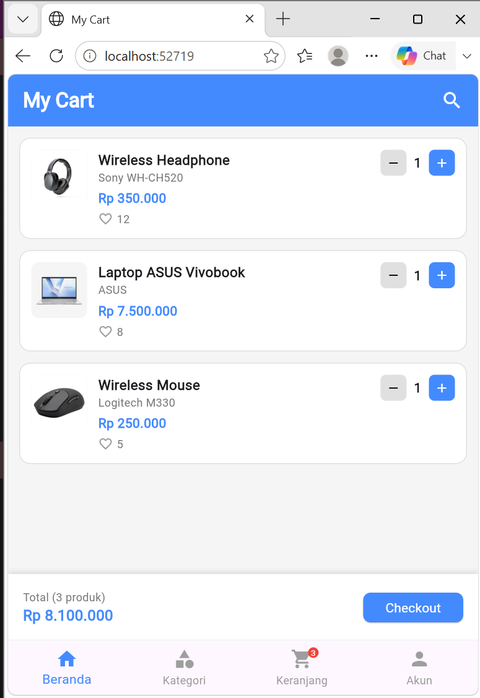

# Aplikasi Shopping Cart

Aplikasi **Shopping Cart sederhana** yang dibuat menggunakan **Flutter** dan **Dart** sebagai Tugas Take Home 1. Aplikasi menampilkan daftar produk dalam keranjang belanja dan memungkinkan pengguna berinteraksi dengan produk tersebut melalui berbagai gesture.

## Identitas

- **Nama:** Teresa
- **NIM:** 825240031

## Tampilan Aplikasi


## Fitur

| No | Fitur | Keterangan |
|----|-------|------------|
| 1 | Daftar produk | Menampilkan 3 produk: Wireless Headphone, Laptop ASUS Vivobook, dan Wireless Mouse |
| 2 | Informasi produk | Setiap produk menampilkan gambar, nama, merk, dan harga |
| 3 | Total belanja | Menampilkan jumlah barang dan total harga yang otomatis berubah mengikuti quantity |
| 4 | Badge keranjang | Jumlah barang ditampilkan pada ikon Keranjang di bottom navigation |

## Interaksi Pengguna

| Interaksi | Respons Tampilan |
|-----------|------------------|
| **Tap** pada produk | Card produk di-highlight (border dan latar berubah menjadi biru). Tap lagi untuk membatalkan |
| **Double tap** pada produk | Seperti like di Instagram: ikon hati menjadi merah dan jumlah like bertambah 1. Double tap lagi untuk unlike (hati kembali abu-abu, like berkurang 1) |
| **Long press** pada produk | Muncul notifikasi hijau di bagian atas: "Produk dipilih! (nama produk) telah dipilih." yang bisa ditutup dengan ikon silang |
| Tombol **+ / -** | Menambah atau mengurangi quantity produk (minimal 1). Total harga dan jumlah barang ikut berubah |
| **Bottom navigation** | Warna item yang diklik berubah menjadi biru (hanya tampilan, tanpa pindah halaman) |

## Konsep Flutter yang Digunakan

- `StatelessWidget` dan `StatefulWidget`
- `setState()` untuk memperbarui tampilan
- `GestureDetector` (`onTap`, `onDoubleTap`, `onLongPress`)
- Widget layout: `Scaffold`, `AppBar`, `Column`, `Row`, `Stack`, `Expanded`, `Container`, `Padding`, `SizedBox`
- `ListView.builder` untuk menampilkan daftar produk
- `Image.asset` untuk menampilkan gambar produk dari folder lokal
- `BottomNavigationBar`
- `ElevatedButton`

> Aplikasi ini **tidak** menggunakan database, API, Firebase, maupun navigasi ke halaman lain. Seluruh data produk disimpan di dalam kode.

## Struktur Project

```
tugastakehome1_825240031/
├── assets/
│   └── images/
│       ├── headphone.png
│       ├── laptop.png
│       └── mouse.png
├── lib/
│   └── main.dart
└── pubspec.yaml
```

## Cara Menjalankan

1. Pastikan **Flutter SDK** sudah terpasang. Cek dengan perintah:
   ```bash
   flutter doctor
   ```
2. Clone repository ini:
   ```bash
   git clone <url-repository-kamu>
   cd tugastakehome1_825240031
   ```
3. Install dependencies:
   ```bash
   flutter pub get
   ```
4. Jalankan aplikasi di emulator atau perangkat yang terhubung:
   ```bash
   flutter run
   ```

## Catatan Gambar Produk

Gambar produk dibaca dari folder `assets/images/` dan sudah didaftarkan pada `pubspec.yaml`:

```yaml
flutter:
  uses-material-design: true

  assets:
    - assets/images/
```

Jika menambahkan atau mengganti gambar, pastikan nama file pada `imagePath` di `lib/main.dart` sama persis dengan nama file aslinya, lalu lakukan *full restart* aplikasi.

## 🛠️ Teknologi

- Flutter
- Dart (SDK `^3.13.0`)
